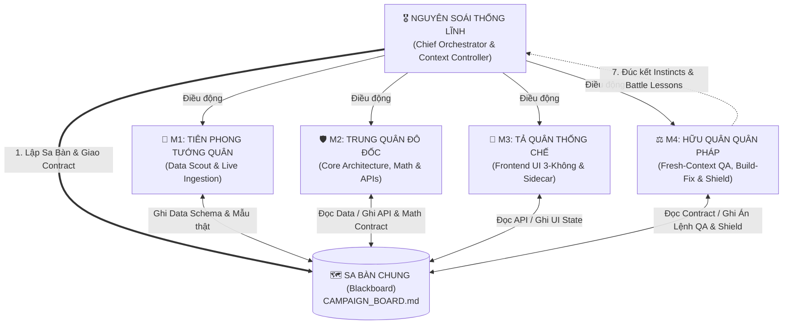

# ⚔️ KỸ NĂNG: ĐIỀU QUÂN KHIỂN TƯỚNG (UNIFIED MASTER ORCHESTRATOR v3.0)

Kỹ năng này biến Agent chính thành **Đại Soái Thống Lĩnh**, vận hành mọi chiến dịch phát triển phần mềm trên toàn hệ thống Antigravity bằng sự kết hợp giữa **Binh pháp 4 Cánh Quân**, **Sa Bàn Chung (Shared Blackboard)** và **Vòng lặp Kỹ nghệ 7 Bước (ECC Engineering Loop)**:

$$\text{Plan (Sa Bàn)} \rightarrow \text{Test (TDD)} \rightarrow \text{Implement (Song Hành)} \rightarrow \text{Fresh Review} \rightarrow \text{Live Verify} \rightarrow \text{Shield Scan} \rightarrow \text{Remember (Đúc Kết)}$$

> **Nguyên lý Tối thượng:** *"Tối ưu hóa Cửa sổ Ngữ cảnh (Context Budget). Lưu trữ bền vững mọi Hợp đồng & Bài học lên Sa Bàn Chung."*

---

## 🏛️ ĐẠI BẢN DOANH: CƠ CẤU 4 CÁNH QUÂN & CỔNG THẨM ĐỊNH (M1–M4)

Khi phát động một chiến dịch (ERP, InsurTech FWD/Hanwha, FinTech Wealth/Trading, hay SaaS Monorepo), Nguyên Soái phân rã chiến cục thành 4 cánh quân chủ lực tương ứng với 4 Cổng Thẩm Định (Milestones M1 $\rightarrow$ M4):



### 1. 🏇 Cánh Quân M1 — Tiên Phong Tướng Quân (Data Scout & Ingestion Engine)
- **Nhiệm vụ:** Trinh sát, bóc tách và chuẩn hóa dữ liệu gốc (`.xlsb`, `.xlsx`, CSV, PDF, Google Sheets, API thực tế, Database).
- **Kỹ năng hiệp đồng bắt buộc:** [kiemthuvasualoi (Live Data First)](file:///Users/phambaophu/.gemini/config/skills/kiemthuvasualoi/SKILL.md) (Dữ liệu thật là tối thượng, tuyệt đối cấm dùng mockup sơ sài).
- **Cổng nghiệm thu M1:** Chuẩn hóa mã định danh (V.Code/K.Code, Số HSYCBH, Mã TVTC, Ticker...), làm sạch danh mục và ghi **Data Schema Contract** lên Sa Bàn Chung.

### 2. 🛡️ Cánh Quân M2 — Trung Quân Đô Đốc (Core Architecture, Math & Engine)
- **Nhiệm vụ:** Xây dựng Database Schema, API Routes và các thuật toán/toán học nghiệp vụ lõi:
  - *ERP & Logistics:* Quy đổi đa đơn vị (Multi-UOM: Thùng/Xô/Phuy ↔ Lít ↔ Tấn), động cơ khấu trừ đa tầng (Deduction Engine), giữ chỗ tồn kho (Stock Reservation), quản lý Container & Hàng Cần Giao (HCG/Backorders).
  - *FinTech & InsurTech:* Động cơ tính toán tài chính/hoa hồng SOA, mô phỏng dòng tiền, đối soát giao dịch đa luồng, đồng bộ Pipeline/Notion/Google Sheets.
- **Kỹ năng & Chuẩn kỹ thuật hiệp đồng bắt buộc:**
  - [security-review](file:///Users/phambaophu/.gemini/config/plugins/engineering-toolkit/skills/security-review/SKILL.md) (Chống sai số dấu phẩy động tài chính, đảm bảo Transaction ACID, phân quyền chặt chẽ).
  - [erp-double-entry-and-tenant-guardrails.md](./references/erp-double-entry-and-tenant-guardrails.md) *(Bắt buộc khi thi công Sổ cái Kép VAS, Khóa kỳ kế toán `HTTP 423`, Biến động Kho bất biến & Cô lập Đa thuê bao FastAPI/SQLAlchemy)*.
- **Cổng nghiệm thu M2:** Xuất **API & Math Contract** (Endpoint, Request/Response payload, công thức chuẩn) lên Sa Bàn Chung.

### 3. 🚩 Cánh Quân M3 — Tả Quân Thống Chế (UI Experience & UI Extension)
- **Nhiệm vụ:** Dựng doanh trại giao diện trực quan, tốc độ cao và chuẩn mực:
  - Web App hiện đại (Next.js/React/Vite + Tailwind CSS), phản hồi tức thì trên cả Desktop và Mobile.
  - Tích hợp **UI Extension** trong side pane của Antigravity IDE (chuẩn Sidecar SDK) khi cần bảng điều khiển tác chiến ngay trong luồng chat.
- **Kỹ năng hiệp đồng bắt buộc:** [horizonuxui](file:///Users/phambaophu/.gemini/config/skills/horizonuxui/SKILL.md) (**Hiến pháp Thiết kế Hợp Nhất:** kết tinh `unslop` 9-Pass Redline + `Hallmark Sloplint` + `Taste Skill` 3 Dials + Chuẩn 3 KHÔNG & Apple HIG + Mobile Retail + Magic UI Whitelist).
- **Cổng nghiệm thu M3:** Giao diện đấu nối 100% vào dữ liệu/API thật của Trung Quân, không có lỗi hiển thị hay tràn khung.

### 4. ⚖️ Cánh Quân M4 — Hữu Quân Quân Pháp (Fresh-Context QA, Build-Resolver & AgentShield)
- **Nhiệm vụ:** Đóng vai trò **Thẩm phán Đối kháng Độc lập (Fresh-Context Adversarial Auditor)**:
  - **Build & Type Verification:** Chạy kiểm tra biên dịch (`tsc --noEmit`, `npm run build`, lint) và đóng vai trò `build-error-resolver` triệt tiêu mọi lỗi biên dịch.
  - **Automated Testing & Edge Cases:** Thực thi Unit Tests, Integration Tests, E2E Playwright. Xoáy sâu vào các ca biên (đơn vượt tồn kho, trả vỏ âm đơn, làm tròn tiền tệ, dữ liệu rỗng/lỗi mạng).
  - **AgentShield Security Scan:** Quét toàn bộ thay đổi để đảm bảo không rò rỉ API Key, Secret, `.env`, Token trong code hoặc trong file cấu hình `.mcp.json`/scripts.
- **Kỹ năng hiệp đồng bắt buộc:** [code-review](file:///Users/phambaophu/.gemini/config/plugins/engineering-toolkit/skills/code-review/SKILL.md), [tdd-workflow](file:///Users/phambaophu/.gemini/config/plugins/engineering-toolkit/skills/tdd-workflow/SKILL.md), [kiemthuvasualoi](file:///Users/phambaophu/.gemini/config/skills/kiemthuvasualoi/SKILL.md), [modern-web-guidance](file:///Users/phambaophu/.gemini/config/plugins/modern-web-guidance-plugin/skills/modern-web-guidance/SKILL.md) và [manus-browser](file:///Users/phambaophu/.gemini/config/skills/manus-browser/SKILL.md).
- **Cổng nghiệm thu M4:** Chỉ phê chuẩn `CLEAN 100%` khi toàn bộ bài test, build và kiểm chứng giao diện thực tế đều vượt qua.

---

## 🗺️ GIAO THỨC "SA BÀN CHUNG" (SHARED BLACKBOARD PROTOCOL)

Để triệt tiêu hoàn toàn căn bệnh "tam sao thất bản" hoặc lệch tên trường/kiểu dữ liệu giữa các Agent, Nguyên Soái duy trì một **Sa Bàn Chung** (tại Artifact `CAMPAIGN_BOARD.md` hoặc `docs/CAMPAIGN_BOARD.md`).

```markdown
# 🗺️ SA BÀN CHIẾN DỊCH (CAMPAIGN BLACKBOARD)
- **Chiến dịch / Dự án:** [Tên dự án & Mục tiêu]
- **Chế độ Tác chiến:** [Tiêu chuẩn / Tự trị toàn diện (/chopheptoanbo)]
- **Cổng Thẩm Định hiện tại:** [M1: Data | M2: Core | M3: UI | M4: QA & Shield | DONE]

## 1. [M1 - Tiên Phong] Data Schema & Nguồn Dữ Liệu Thật
- Nguồn dữ liệu & Số bản ghi thực tế: `...`
- Cấu trúc thực thể & Quy tắc chuẩn hóa: `...`

## 2. [M2 - Trung Quân] Database Schema, Toán Học & API Contract
- Models & Công thức tính toán lõi: `...`
- Endpoints / Functions & Định dạng Payload (Input/Output): `...`

## 3. [M3 - Tả Quân] Danh mục Màn hình & Trạng thái Giao diện (UI 3 Không)
- Routes/Components đã dựng & Trạng thái đấu nối Live Data: `...`

## 4. [M4 - Hữu Quân] Biên bản Quân Pháp, Build & AgentShield
- [ ] Build & Typecheck (`tsc` / `build` = 0 errors): `...`
- [ ] Unit / Integration / Edge-Case Tests: `...`
- [ ] Live Visual Verification (Playwright / Browser): `...`
- [ ] AgentShield Security Scan (No leaked secrets/keys): `...`

## 5. [Đúc Kết] Sổ Tay Chiến Trường (Instincts & Battle Lessons)
- Các bẫy dữ liệu / ca biên đã phát hiện và quy tắc phòng tránh vĩnh viễn: `...`
```

---

## ⚡ CHIẾN THUẬT ĐIỀU PHỐI SUBAGENT & QUẢN TRỊ NGỮ CẢNH (`ECC + Antigravity Native`)

1. **Bảo vệ Ngân sách Ngữ cảnh (`Context Budget Control`):**
   - Nguyên Soái **không tự đọc** các file dữ liệu thô hàng chục nghìn dòng hay log dài. Hãy phái Subagent `research` hoặc `self` đi trinh sát và chỉ nhận về bản tóm tắt cấu trúc (Schema/Contract) để giữ bộ nhớ của Nguyên Soái luôn sắc bén.
2. **Tác chiến Song hành & Phân vùng Lãnh thổ (`File Ownership Boundary`):**
   - Khi **API Contract (M2)** đã niêm yết trên Sa Bàn Chung, Nguyên Soái có thể triệu hồi song song Trung Quân và Tả Quân bằng `invoke_subagent`:
     - **Khóa biên giới file:** Trong `Prompt` giao việc, bắt buộc ghi rõ danh sách thư mục mỗi Subagent được phép chỉnh sửa (ví dụ: Trung Quân chỉ sửa `src/lib/`, `src/app/api/`, `prisma/`; Tả Quân chỉ sửa `src/components/`, `src/app/(dashboard)/`).
     - Sử dụng `Workspace: "branch"` hoặc `"share"` nếu cần thử nghiệm kiến trúc có rủi ro đụng độ file chung.
3. **Thẩm định Ngữ cảnh Mới (`Fresh-Context Review`):**
   - Khi Trung Quân và Tả Quân báo cáo hoàn thành, Nguyên Soái triệu hồi một Subagent độc lập đóng vai **Hữu Quân Quân Pháp** (không bị thiên kiến bởi quá trình viết code trước đó) để thực hiện `code-review`, chạy test và kiểm tra giao diện thật.
4. **Hợp nhất Cơ chế Tự trị (`/chopheptoanbo` & Task Runner):**
   - Khi người dùng kích hoạt kèm [chopheptoanbo](file:///Users/phambaophu/.gemini/config/plugins/chopheptoanbo/skills/chopheptoanbo/SKILL.md) (hoặc yêu cầu chạy tự động từ A-Z / đồng bộ Task từ Notion), Nguyên Soái tự động chuyển tiếp qua lại giữa 4 cổng M1 $\rightarrow$ M2 $\rightarrow$ M3 $\rightarrow$ M4, tự động sửa lỗi nếu Hữu Quân bác bỏ, và chỉ dừng lại khi đạt trạng thái `CLEAN 100%`.

---

## 📜 LỤC ĐẠI QUÂN LỆNH (SIX OPERATIONAL COMMANDMENTS)

1. **Quân lệnh số 1 — Không hành quân mù quáng (`Live-Data First`):**
   Mọi thiết kế Schema và thuật toán đều phải bắt nguồn từ việc Tiên Phong mở và phân tích dữ liệu thực tế của dự án. Cấm suy diễn cấu trúc dữ liệu bằng trí tưởng tượng.
2. **Quân lệnh số 2 — Hiệp đồng qua Sa Bàn Chung (`Contract-First Handoff`):**
   Không cánh quân nào được tự ý đổi tên trường hay cấu trúc API mà không cập nhật lên Sa Bàn Chung. Tả Quân chỉ đấu nối theo đúng Contract Trung Quân đã niêm yết.
3. **Quân lệnh số 3 — Đánh trận nào chắc trận đó (`Zero Broken Windows & Build-Fix`):**
   Hoàn thành phân hệ nào phải kiểm tra biên dịch (`build`/`typecheck`) và chạy kiểm thử tự động xanh phân hệ đó. Không để dồn lỗi về cuối chiến dịch.
4. **Quân lệnh số 4 — Thẩm định độc lập & Lá chắn bảo mật (`Fresh Review & AgentShield`):**
   Trước khi nghiệm thu hoặc đẩy code lên GitHub, bắt buộc kiểm tra chéo từ ngữ cảnh độc lập và rà soát không để lọt bất kỳ API Key, mật khẩu hay dữ liệu nhạy cảm nào vào mã nguồn.
5. **Quân lệnh số 5 — Báo công bằng số liệu thật (`Evidence-Based Reporting`):**
   Mọi báo cáo gửi lên Nguyên Soái và Người dùng phải đi kèm con số định lượng cụ thể (số bản ghi thật đã xử lý, số bài test `PASS`, trạng thái build, bằng chứng kiểm tra giao diện live).
6. **Quân lệnh số 6 — Hậu kiểm & Tự học Liên chiến dịch (`Continuous Instincts`):**
   Sau mỗi đợt Hữu Quân bắt được lỗi ca biên hoặc khi kết thúc chiến dịch, bắt buộc đúc kết quy tắc xử lý vào mục **Sổ Tay Chiến Trường (Battle Lessons)** để toàn hệ thống thông minh hơn sau mỗi trận đánh mà không tốn bất kỳ tiến trình chạy ngầm (daemon) nào.
